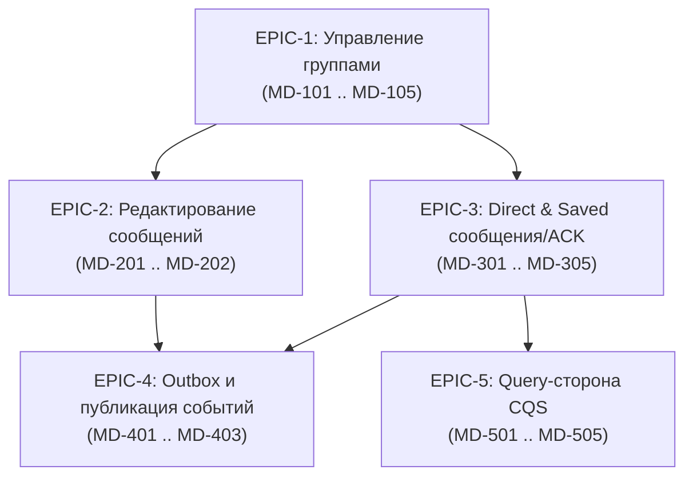

# ТЗ и бэклог задач: Application-слой Messages and Dialogues Service

## Контекст и архитектурные инварианты

Все задачи бэклога предназначены для автономного выполнения AI-агентом в соответствии с правилами [AGENTS.md](file:///c:/Projects/Andruha/services/messages-dialogues-service/AGENTS.md) и гексагональной архитектурой Andruha:
- **Изоляция слоёв**: `entrypoints → application → domain`. В application-слое запрещены любые зависимости от транспортных фреймворков (`FastAPI`, `Starlette`), драйверов/ORM (`cassandra`, `sqlalchemy`), внешних клиентов и `core`.
- **Контракты команд**: Наследование от `BaseCommand[ResultT]`, неизменяемость (`frozen=True`, `extra="forbid"`, `validate_default=True`).
- **Rich Domain**: Бизнес-правила охраняются доменными агрегатами (`GroupDialog`, `DirectDialog`, `SavedDialog`, `Message`, `ReceiptWatermark`) и политиками (`MessagePostingPolicy`). Application координирует сценарии, порты, проверки в Identity/Object Storage и транзакционность.
- **TDD и неприкосновенность существующих тестов**: Разработка через RED → GREEN → REFACTOR. Тестирование на in-memory fake-портах. Изменение существующих тестов запрещено.
- **Python 3.14**: Современный синтаксис типов (`T | None`, `tuple[T, ...]`, `uuid7()`), отсутствие legacy `Union`/`Optional`.

---

## Карта эпиков



---

## EPIC-1: Управление жизненным циклом групп (Group Lifecycle Commands)

### MD-101: Команда и хэндлер создания группового диалога (`CreateGroupDialogCommand`)
- **Тип**: User Story
- **Приоритет**: Highest
- **Цель**: Предоставить application-сценарий создания новой группы с валидацией участников и аватара, начальной фиксацией ревизии и обеспечением проекций.
- **Затрагиваемые границы**:
  - `src/app/application/commands/groups/create_group/` (`command.py`, `handler.py`, `result.py`, `__init__.py`)
  - `src/app/application/ports/persistence/repositories/group_commands.py` (добавление метода `create_group` в протокол)
  - `src/app/application/ports/projections/dialogues.py` (поддержка `GroupDialog` в `ensure_for_user`)
  - `tests/unit/application/groups/test_group_creation.py`
- **Спецификация**:
  ```python
  class CreateGroupDialogCommand(BaseCommand[CreateGroupDialogResult]):
      actor_id: UUID
      title: str
      initial_member_ids: tuple[UUID, ...] = Field(default=())
      avatar_object_id: UUID | None = Field(default=None)
  ```
  1. Валидация заголовка через `GroupTitle.from_str`.
  2. Проверка регистрации `actor_id` и всех `initial_member_ids` через `RegisteredUsersProtocol.require_registered`.
  3. Если передан `avatar_object_id`, проверка через `AttachmentVerifierProtocol.require_ready(actor_id, (ObjectId(avatar_object_id),))`.
  4. Создание агрегата через `GroupDialog.create(title=..., owner_id=actor_id, initial_members=..., avatar_object_id=..., now=clock(), dialog_id=ids())`.
  5. Сохранение в `GroupCreationRepositoryProtocol.create_group(group)` с начальной `revision=1` и `last_position=0`.
  6. Вызов `ensure_dialog_projections` для всех участников группы (`group.members`).
  7. Возврат `CreateGroupDialogResult(dialog=GroupDialogDTO.from_domain(group))`.
- **Критерии приёмки (AC)**:
  - [ ] Создатель автоматически входит в список участников группы как владелец (`owner_id`).
  - [ ] Незарегистрированный создатель или участник вызывает `UserNotRegisteredError`, группа не создаётся.
  - [ ] Неготовый аватар вызывает ошибку Object Storage, группа не создаётся.
  - [ ] Ошибка проекции у любого участника вызывает `DialogProjectionsIncompleteError` с сохранением канонической группы.
  - [ ] Полнота типов Python 3.14, 100% покрытие сценария unit-тестами.

---

### MD-102: Команда и хэндлер переименования группы (`RenameGroupDialogCommand`)
- **Тип**: User Story
- **Приоритет**: High
- **Цель**: Позволить участнику группы изменить название группы с CAS-контролем ревизии и идемпотентностью.
- **Затрагиваемые границы**:
  - `src/app/application/commands/groups/rename/`
  - `src/app/application/ports/persistence/repositories/group_commands.py`
  - `tests/unit/application/groups/test_group_rename.py`
- **Спецификация**:
  ```python
  class RenameGroupDialogCommand(BaseCommand[GroupDialogDTO]):
      dialog_id: UUID
      actor_id: UUID
      command_id: UUID
      new_title: str
  ```
  1. Цикл до `max_attempts` (по умолчанию `MAX_GROUP_COMMAND_ATTEMPTS = 8`).
  2. Загрузка `snapshot = await groups.get_by_id(dialog_id)`. Если `None` → `DialogNotFoundError`.
  3. Проверка `command_id` на `at_revision=snapshot.revision`. Если команда с этим `command_id` уже применена и intent совпадает → возврат кэшированного `GroupDialogDTO`. При несовпадении полей → `GroupMembershipConflictError`.
  4. Копия `group = snapshot.dialog.model_copy(deep=True)`.
  5. Вызов `group.rename(new_title, now=clock(), actor_id=actor_id)`.
  6. `try_commit_metadata(snapshot, group, command_id=command_id)` (атомарная проверка ревизии, сохранение новой версии группы и результата команды).
  7. При успехе возврат `GroupDialogDTO.from_domain(group)`.
- **Критерии приёмки (AC)**:
  - [ ] Не-участник группы получает `NotGroupMemberError`.
  - [ ] Пустое название или превышение лимита символов отклоняется валидатором `GroupTitle`.
  - [ ] Совпадающее название (no-op) успешно подтверждается без изменения версии группы.
  - [ ] Конфликт ревизии инициирует повтор; при исчерпании 8 попыток возвращается `ConcurrentModificationError`.

---

### MD-103: Смена и удаление аватара группы (`ChangeGroupAvatarCommand`, `RemoveGroupAvatarCommand`)
- **Тип**: User Story
- **Приоритет**: Medium
- **Цель**: Обеспечить привязку и удаление аватара группы с внешней проверкой прав в Object Storage и CAS-фиксацией.
- **Затрагиваемые границы**:
  - `src/app/application/commands/groups/change_avatar/`
  - `src/app/application/commands/groups/remove_avatar/`
  - `tests/unit/application/groups/test_group_avatar_commands.py`
- **Спецификация**:
  1. `ChangeGroupAvatarCommand(dialog_id, actor_id, command_id, avatar_object_id)`.
  2. Валидация готовности: `AttachmentVerifierProtocol.require_ready(actor_id, (ObjectId(avatar_object_id),))`.
  3. Вызов `group.change_avatar(avatar_object_id, now=clock(), actor_id=actor_id)`.
  4. `RemoveGroupAvatarCommand(dialog_id, actor_id, command_id)` → вызов `group.remove_avatar(now=clock(), actor_id=actor_id)`.
  5. Условная CAS-запись мутации группы по протоколу ревизии.
- **Критерии приёмки (AC)**:
  - [ ] Чужой или неподтверждённый объект аватара отклоняется до попытки коммита.
  - [ ] Удаление аватара у группы без аватара — идемпотентный no-op.
  - [ ] Смена аватара доступна любому текущему участнику группы (`require_can_read`).

---

### MD-104: Команда передачи владения группой (`TransferGroupOwnershipCommand`)
- **Тип**: User Story
- **Приоритет**: High
- **Цель**: Передача прав владельца группы другому действующему участнику.
- **Затрагиваемые границы**:
  - `src/app/application/commands/groups/transfer_ownership/`
  - `tests/unit/application/groups/test_transfer_ownership.py`
- **Спецификация**:
  ```python
  class TransferGroupOwnershipCommand(BaseCommand[GroupDialogDTO]):
      dialog_id: UUID
      actor_id: UUID
      new_owner_id: UUID
      command_id: UUID
  ```
  1. Вызов `group.change_owner(new_owner_id, now=clock(), actor_id=actor_id)`.
  2. Доменная проверка: только текущий владелец (`owner_id == actor_id`) может передать владение; `new_owner_id` обязан быть в `members`.
  3. CAS-коммит по ревизии группы с сохранением `command_id`.
- **Критерии приёмки (AC)**:
  - [ ] Попытка вызова не владельцем возбуждает `NotGroupOwnerError`.
  - [ ] Передача пользователю не из числа участников возбуждает `NotGroupMemberError`.
  - [ ] При успехе `owner_id` обновляется, прежний владелец остаётся обычным участником (`members`).

---

### MD-105: Добровольный выход участника из группы (`LeaveGroupCommand`)
- **Тип**: User Story
- **Приоритет**: High
- **Цель**: Выделенный use case для самостоятельного выхода пользователя из группы.
- **Затрагиваемые границы**:
  - `src/app/application/commands/groups/leave_group/`
  - `tests/unit/application/groups/test_leave_group.py`
- **Спецификация**:
  ```python
  class LeaveGroupCommand(BaseCommand[GroupDialogDTO]):
      dialog_id: UUID
      actor_id: UUID
      command_id: UUID
  ```
  1. Вызов `group.remove_member(actor_id, now=clock(), actor_id=actor_id)`.
  2. Если выходящий является владельцем (`owner_id == actor_id`), домен возбуждает `CannotRemoveOwnerError` (владелец обязан сначала передать группу через MD-104).
  3. Условная запись через `try_commit_membership` с действием `MembershipAction.REMOVE`.
- **Критерии приёмки (AC)**:
  - [ ] Обычный участник успешно покидает группу, исключаясь из `members`.
  - [ ] Владелец группы не может выйти без предварительной передачи владения (`CannotRemoveOwnerError`).
  - [ ] Повторный вызов с тем же `command_id` идемпотентно возвращает результат прежней операции.

---

## EPIC-2: Редактирование текста сообщений (Message Text Editing Use Case)

### MD-201: Расширение портов репозитория для редактирования сообщений
- **Тип**: Technical Task
- **Приоритет**: Highest
- **Цель**: Спроектировать методы репозитория для загрузки сообщения по ID на ревизии и атомарного CAS-сохранения новой редакции.
- **Затрагиваемые границы**:
  - `src/app/application/ports/persistence/repositories/group_commands.py`
  - `src/app/application/ports/persistence/models.py`
- **Спецификация**:
  1. В `GroupMessageRepositoryProtocol` добавить метод:
     ```python
     async def get_message_by_id(
         self, dialog_id: UUID, message_id: UUID, *, at_revision: int
     ) -> Message | None: ...
     ```
  2. Уточнить контракт `try_commit`: мутация `Message` с `version > expected.version` проверяет совпадение `expected_message_version` (защита от concurrent edit) и увеличивает `revision` группы.
- **Критерии приёмки (AC)**:
  - [x] Контракт не зависит от деталей Cassandra / SQL.
  - [x] Неподтверждённая ревизия возбуждает `GroupReadConflictError`.

---

### MD-202: Команда и хэндлер редактирования текста сообщения в группе (`EditGroupMessageTextCommand`)
- **Тип**: User Story
- **Приоритет**: Highest
- **Цель**: Реализовать сценарий редактирования текста сообщения в соответствии с [docs/message-text-editing-2026-09-30.md](file:///c:/Projects/Andruha/services/messages-dialogues-service/docs/message-text-editing-2026-09-30.md).
- **Затрагиваемые границы**:
  - `src/app/application/commands/groups/edit_message/` (`command.py`, `handler.py`, `result.py`)
  - `tests/unit/application/groups/test_message_editing_handler.py`
- **Спецификация**:
  ```python
  class EditGroupMessageTextCommand(BaseCommand[EditGroupMessageTextResult]):
      dialog_id: UUID
      actor_id: UUID
      message_id: UUID
      new_text: str | None
      command_id: UUID
  ```
  1. Загрузка `snapshot = await groups.get_by_id(dialog_id)`.
  2. Проверка прав читателя: `snapshot.dialog.require_can_read(actor_id)`.
  3. Загрузка сообщения: `message = await groups.get_message_by_id(dialog_id, message_id, at_revision=snapshot.revision)`. Если `None` → `MessageNotFoundError`.
  4. Клонирование: `candidate = message.model_copy(deep=True)`.
  5. Вызов `changed = candidate.edit_text(actor_id=actor_id, text=new_text, now=clock())`.
     - Проверка авторства (`NotMessageAuthorError` если `actor_id != message.sender_id`).
     - Нормализация текста (NFC, обрезка, лимит 4096).
  6. Если `changed == False` (эквивалентный текст):
     - CAS `try_commit(snapshot, None, command_id=command_id)` для проверки прав.
  7. Если `changed == True`:
     - CAS `try_commit(snapshot, candidate, command_id=command_id)`.
  8. Возврат `EditGroupMessageTextResult(message=MessageDTO.from_domain(candidate), group_version=snapshot.dialog.version, changed=changed)`.
- **Критерии приёмки (AC)**:
  - [x] Не-автор сообщения получает отказ `NotMessageAuthorError`.
  - [x] Повтор с тем же текстом возвращает `changed=False`, не увеличивает `version` сообщения и не меняет `edited_at`.
  - [x] Первая реальная правка выставляет `version=2`, `is_edited=True`, `edited_at=now`.
  - [x] Нельзя оставить сообщение без текста и вложений (`EmptyMessageError`).
  - [x] Гонка обновления состава группы во время редактирования вызывает retry по `ConcurrentModificationError`.

---

## EPIC-3: Direct & Saved сообщения и Receipts

### MD-301: Порты репозиториев для сообщений и receipts личных диалогов
- **Тип**: Technical Task
- **Приоритет**: Highest
- **Цель**: Описать протоколы долговременного хранения сообщений и receipts для `DirectDialog` и `SavedDialog` в соответствии с главой 03.
- **Затрагиваемые границы**:
  - `src/app/application/ports/persistence/repositories/direct_messages.py`
  - `src/app/application/ports/persistence/repositories/direct_receipts.py`
- **Спецификация**:
  ```python
  class DirectMessageRepositoryProtocol(Protocol):
      async def get_by_send_key(self, send_key: MessageSendKey) -> Message | None: ...
      async def get_last_position(self, dialog_id: UUID) -> int: ...
      async def save_message(self, message: Message, *, idempotency_key: MessageSendKey) -> Message: ...

  class DirectReceiptRepositoryProtocol(Protocol):
      async def get_watermark(self, dialog_id: UUID, user_id: UUID) -> ReceiptWatermark | None: ...
      async def save_watermark(self, watermark: ReceiptWatermark, *, expected_version: int) -> bool: ...
  ```
- **Критерии приёмки (AC)**:
  - [x] Контракты обеспечивают LWT-гарантии (уникальность `MessageSendKey` в бакете месяца и монотонность версий watermark).

---

### MD-302: Команда и хэндлер отправки сообщения в 1:1 диалог (`SendDirectMessageCommand`)
- **Тип**: User Story
- **Приоритет**: Highest
- **Цель**: Реализовать use case отправки сообщения между двумя пользователями по контракту `message.send.v1`.
- **Затрагиваемые границы**:
  - `src/app/application/commands/dialogues/send_direct_message/`
  - `tests/unit/application/dialogues/test_send_direct_message.py`
- **Спецификация**:
  1. Загрузка `DirectDialog` по `dialog_id`.
  2. Проверка участия: `dialog.require_can_send(actor_id)`.
  3. Проверка существования отправки по `MessageSendKey(actor_id, client_message_id)`.
  4. При повторе: если совпадает с текущим/отредактированным сообщением → возврат существующего. При конфликте исходного контента → `MessageSendConflictError`.
  5. Проверка вложений через `AttachmentVerifierProtocol`.
  6. Получение позиции: `last_pos = await direct_messages.get_last_position(dialog_id)`.
  7. Создание через `MessagePostingPolicy.create_message(dialog=dialog, position=last_pos + 1, ...)`.
  8. Атомарное сохранение сообщения и резервации ключа.
- **Критерии приёмки (AC)**:
  - [x] Отправка пользователем, не входящим в пару диалога, возбуждает `NotDialogParticipantError`.
  - [x] Позиции сообщений строго возрастают: 1, 2, 3...
  - [x] Идемпотентный повтор возвращает созданное ранее сообщение.

---

### MD-303: Отправка заметок в «Избранное» (`SendSavedMessageCommand`)
- **Тип**: User Story
- **Приоритет**: High
- **Цель**: Use case отправки заметок/сообщений самому себе в `SavedDialog`.
- **Затрагиваемые границы**:
  - `src/app/application/commands/dialogues/send_saved_message/`
  - `tests/unit/application/dialogues/test_send_saved_message.py`
- **Спецификация**:
  1. Загрузка `SavedDialog`. Проверка: `dialog.user_id == actor_id`.
  2. Проверка вложений через `AttachmentVerifierProtocol`.
  3. `MessagePostingPolicy.create_message`.
  4. Сохранение сообщения. Для `SavedDialog` receipt watermarks не создаются (`supports_receipts = False`).
- **Критерии приёмки (AC)**:
  - [x] Попытка отправки в чужой `SavedDialog` отклоняется.
  - [x] Receipt watermarks не инициализируются и не продвигаются.

---

### MD-304: Продвижение Receipts в 1:1 диалоге (`AdvanceDirectReceiptCommand`)
- **Тип**: User Story
- **Приоритет**: Highest
- **Цель**: Реализация обновления `DELIVERED` и `READ` watermarks в личных диалогах по контракту `receipt.advance.v1`.
- **Затрагиваемые границы**:
  - `src/app/application/commands/dialogues/advance_direct_receipt/`
  - `tests/unit/application/dialogues/test_advance_direct_receipt.py`
- **Спецификация**:
  1. Загрузка `DirectDialog`, проверка `dialog.require_can_read(actor_id)`.
  2. Загрузка целевого сообщения `through_message_id`. Проверка принадлежности диалогу.
  3. Загрузка текущего `ReceiptWatermark` для `(dialog_id, actor_id)`. Если отсутствует → `ReceiptWatermark.create_empty(...)`.
  4. Вызов `advance_delivered` или `advance_read`.
  5. Условное сохранение с проверкой `expected_version` (OCC).
- **Критерии приёмки (AC)**:
  - [x] Отметка `READ` гарантирует `DELIVERED >= READ`.
  - [x] Устаревший или меньший checkpoint — безопасный no-op (`changed=False`).
  - [x] Версия статуса строго монотонна.

---

### MD-305: Единый фасад маршрутизации команд сообщений и receipts
- **Тип**: Task
- **Приоритет**: High
- **Цель**: Предоставить единую точку входа для WebSocket Gateway и Kafka consumers, принимающих обобщённые `message.send.v1` и `receipt.advance.v1` с одним полем `dialogId`.
- **Затрагиваемые границы**:
  - `src/app/application/commands/messaging/` (`send_message_facade.py`, `advance_receipt_facade.py`)
  - `src/app/application/ports/persistence/repositories/dialog_lookup.py`
  - `tests/unit/application/messaging/test_facade_routing.py`
- **Спецификация**:
  1. Определение типа диалога по `dialog_id` через легковесный `DialogLookupProtocol.get_dialog_kind(dialog_id)` (`DIRECT`, `GROUP`, `SAVED`).
  2. Маршрутизация в соответствующий хэндлер:
     - `GROUP` → `SendGroupMessageHandler` / `AdvanceGroupReceiptHandler`;
     - `DIRECT` → `SendDirectMessageHandler` / `AdvanceDirectReceiptHandler`;
     - `SAVED` → `SendSavedMessageHandler` (для receipts возбуждает отказ/no-op).
- **Критерии приёмки (AC)**:
  - [x] Несуществующий `dialog_id` вызывает `DialogNotFoundError`.
  - [x] Корректное прозрачное делегирование без дублирования бизнес-логики.

---

## EPIC-4: Outbox и публикация интеграционных событий

### MD-401: Порт Outbox и детерминированная фабрика событий
- **Тип**: Technical Task
- **Приоритет**: Highest
- **Цель**: Спроектировать порт сохранения интеграционных событий и детерминированную генерацию UUID событий по главе 03.
- **Затрагиваемые границы**:
  - `src/app/application/ports/events/outbox.py`
  - `src/app/application/events/models.py`
  - `src/app/application/events/factory.py`
  - `tests/unit/application/events/test_event_factory.py`
- **Спецификация**:
  1. Формула UUIDv5: `message_event_id(message_id, event_type, target_user_id)`.
  2. Определение моделей событий согласно контрактам Andruha:
     - `MessagePersistedEvent` (`targetUserId = sender_id`);
     - `MessageCreatedEvent` (`targetUserId = recipient_id`);
     - `ReceiptWatermarkAdvancedEvent` (`targetUserId = original_sender_id`);
     - `MessageRejectedEvent` (при конфликте отправки).
  3. `OutboxRepositoryProtocol.save_events(events: tuple[IntegrationEvent, ...])`.
- **Критерии приёмки (AC)**:
  - [ ] Одинаковые входные аргументы всегда дают идентичный `event_id` (детерминизм).
  - [ ] Wire-поле партиционирования Kafka — `targetUserId`.

---

### MD-402: Интеграция Outbox-событий в хэндлеры отправки сообщений
- **Тип**: User Story
- **Приоритет**: High
- **Цель**: Генерировать и атомарно сохранять события `message.persisted.v1` и `message.created.v1` при успешной отправке сообщения.
- **Затрагиваемые границы**:
  - `src/app/application/commands/groups/send_message/handler.py`
  - `src/app/application/commands/dialogues/send_direct_message/handler.py`
  - `tests/unit/application/groups/test_message_acceptance.py`
- **Спецификация**:
  1. При новой успешной отправке сообщения в группу:
     - Создание `MessagePersistedEvent` для автора;
     - Создание `MessageCreatedEvent` для каждого участника `members - {sender_id}`.
  2. При отправке в direct:
     - `MessagePersistedEvent` для автора;
     - `MessageCreatedEvent` для `peer_id`.
  3. Передача событий в репозиторий для атомарного коммита вместе с сообщением.
- **Критерии приёмки (AC)**:
  - [ ] При replay отправки генерируются те же самые `event_id`.
  - [ ] При конфликте полезной нагрузки генерируется `MessageRejectedEvent`.

---

### MD-403: Интеграция Outbox-событий в хэндлеры продвижения Receipts
- **Тип**: User Story
- **Приоритет**: High
- **Цель**: Генерировать событие `receipt.watermark_advanced.v1` при реальном продвижении watermark.
- **Затрагиваемые границы**:
  - `src/app/application/commands/groups/advance_receipt/handler.py`
  - `src/app/application/commands/dialogues/advance_direct_receipt/handler.py`
- **Спецификация**:
  1. Если `changed == True`, формирование `ReceiptWatermarkAdvancedEvent(dialog_id, user_id, kind, through_message_id, status_version, targetUserId=sender_id)`.
  2. Если `changed == False` (no-op duplicate), события не генерируются.
- **Критерии приёмки (AC)**:
  - [ ] No-op продвижение не создаёт дублирующих событий.
  - [ ] `targetUserId` указывает на автора прочитанных сообщений.

---

## EPIC-5: Query-сторона (Read Use Cases / CQS)

### MD-501: Базовая инфраструктура Query-слоя и DTO чтения
- **Тип**: Technical Task
- **Приоритет**: High
- **Цель**: Создать каталог `src/app/application/queries/`, базовый класс `BaseQuery[ResultT]` и DTO результатов чтения.
- **Затрагиваемые границы**:
  - `src/app/application/queries/base.py`
  - `src/app/application/dto/queries.py`
- **Спецификация**:
  1. `BaseQuery[ResultT]` с frozen pydantic.
  2. DTO: `DialogListItemDTO`, `MessageHistoryItemDTO`, `SyncEventDTO`, `CursorDTO`.
- **Критерии приёмки (AC)**:
  - [ ] Строгое разделение Command (мутации) и Query (чтение без побочных эффектов).

---

### MD-502: Запрос списка диалогов пользователя (`GetDialogListQuery`)
- **Тип**: User Story
- **Приоритет**: High
- **Цель**: Получение постраничного списка последних диалогов пользователя с фильтрацией устаревших строк активности.
- **Затрагиваемые границы**:
  - `src/app/application/queries/get_dialog_list/`
  - `src/app/application/ports/persistence/queries/dialog_list.py`
  - `tests/unit/application/queries/test_dialog_list_query.py`
- **Спецификация**:
  ```python
  class GetDialogListQuery(BaseQuery[DialogListPageDTO]):
      user_id: UUID
      cursor: str | None = None
      limit: int = Field(default=50, ge=1, le=100)
  ```
  1. Валидация курсора (opaque HMAC-токен с проверкой `subject=user_id`).
  2. Опрос порта `DialogListQueryRepositoryProtocol.read_activity(user_id, cursor, limit * 3)`.
  3. Проверка шардов указателей (`dialog_position_by_user_shard`) для отсеивания stale activity rows.
  4. Формирование страницы до `limit` элементов и нового курсора следующей страницы.
- **Критерии приёмки (AC)**:
  - [ ] Чужой курсор отклоняется.
  - [ ] Дубликаты диалогов из-за обновления активности схлопываются до актуальной позиции.

---

### MD-503: Запрос истории сообщений диалога (`GetMessageHistoryQuery`)
- **Тип**: User Story
- **Приоритет**: High
- **Цель**: Курсорное получение истории сообщений с расчётом эффективного статуса `SENT / DELIVERED / READ`.
- **Затрагиваемые границы**:
  - `src/app/application/queries/get_message_history/`
  - `src/app/application/ports/persistence/queries/message_history.py`
  - `tests/unit/application/queries/test_message_history_query.py`
- **Спецификация**:
  ```python
  class GetMessageHistoryQuery(BaseQuery[MessageHistoryPageDTO]):
      dialog_id: UUID
      actor_id: UUID
      cursor: str | None = None
      limit: int = Field(default=50, ge=1, le=100)
  ```
  1. Проверка доступа: `dialog.require_can_read(actor_id)`. Для не-участника → `DialogNotFoundError` (скрытие существования).
  2. Чтение порции сообщений из репозитория истории по бакетам месяцев.
  3. Чтение текущих `ReceiptWatermark` для собеседников диалога.
  4. Расчёт статуса каждого сообщения:
     - `position <= read_through` → `READ`;
     - `position <= delivered_through` → `DELIVERED`;
     - иначе → `SENT`.
  5. Возврат страницы `MessageDTO` с вычисленными статусами и курсором.
- **Критерии приёмки (AC)**:
  - [ ] Не-участник диалога получает `DialogNotFoundError`.
  - [ ] Статусы сообщений всей страницы рассчитываются за один запрос watermarks без N+1.

---

### MD-504: Запрос дельты синхронизации (`GetSyncEventsQuery`)
- **Тип**: User Story
- **Приоритет**: High
- **Цель**: Получение событий для `/sync` при восстановлении соединения клиента.
- **Затрагиваемые границы**:
  - `src/app/application/queries/get_sync_events/`
  - `src/app/application/ports/persistence/queries/sync_events.py`
  - `tests/unit/application/queries/test_sync_query.py`
- **Спецификация**:
  ```python
  class GetSyncEventsQuery(BaseQuery[SyncEventsPageDTO]):
      user_id: UUID
      cursor: str | None = None
      limit: int = Field(default=100, ge=1, le=200)
  ```
  1. Если курсор старше 30 дней (retention boundary) → возбуждение `FullResyncRequiredError` (мапится в HTTP 410).
  2. Чтение событий из суточных бакетов `sync_events_by_user_bucket` в хронологическом порядке (`sync_time ASC`).
  3. Возврат событий и нового курсора.
- **Критерии приёмки (AC)**:
  - [ ] Устаревший курсор гарантированно возвращает `FullResyncRequiredError`.
  - [ ] Порядок событий строго монотонный.

---

### MD-505: Запросы точечного чтения (`GetDialogByIdQuery`, `GetMessageByIdQuery`)
- **Тип**: Task
- **Приоритет**: Medium
- **Цель**: Предоставить легковесные запросы получения информации о диалоге и отдельном сообщении.
- **Затрагиваемые границы**:
  - `src/app/application/queries/get_dialog_by_id/`
  - `src/app/application/queries/get_message_by_id/`
  - `tests/unit/application/queries/test_point_queries.py`
- **Спецификация**:
  1. `GetDialogByIdQuery(dialog_id, actor_id)`: проверка членства, возврат `DirectDialogDTO` / `GroupDialogDTO`.
  2. `GetMessageByIdQuery(dialog_id, message_id, actor_id)`: проверка доступа к сообщению в диалоге через `dialog.require_message_access(...)`.
- **Критерии приёмки (AC)**:
  - [ ] Чужие диалоги и сообщения недоступны сторонним пользователям.

---

## Рекомендуемый порядок реализации (Итерации)

| Итерация | Состав задач | Результат |
|---|---|---|
| **Итерация 1** | MD-101, MD-102, MD-103, MD-104, MD-105 | Полный жизненный цикл групповых диалогов (создание, переименование, аватар, передача владения, выход). |
| **Итерация 2** | MD-201, MD-202 | Поддержка редактирования текста сообщений в группах с CAS-ревизией. |
| **Итерация 3** | MD-301, MD-302, MD-303, MD-304, MD-305 | Отправка сообщений и receipts для личных и Saved диалогов + единый фасад. |
| **Итерация 4** | MD-401, MD-402, MD-403 | Детерминированные Outbox-события для отправки сообщений и ACK. |
| **Итерация 5** | MD-501, MD-502, MD-503, MD-504, MD-505 | Query-слой: списки диалогов, история сообщений с вычислением статусов и `/sync`. |
